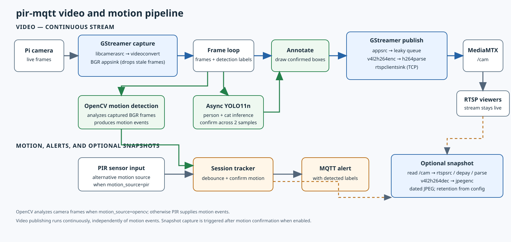

#### This repo is derived from my Capstone Project:
https://github.com/cu-ecen-aeld/final-project-eduardpo/wiki/Final-Project-Overview

Added support for RTP/RTSP/WebRTC streaming, OpenCV motion detection to complement infrared detection, and the pir_mqtt app in the custom layer.

- mqtt_motion_stream.py: mqtt listener managed by service firing gst-launch playback on received alert
- mqtt-motion-stream.service: should be placed inside: *~/.config/systemd/user/*
- to check for sercvice status: *systemctl --user status mqtt_motion_stream.service*

<p float="left">
  
  
</p>

## Building with kas

The build runs kas 5.5 in an Ubuntu 22.04 container, keeping the Wrynose build
environment independent of the host distribution. Install Docker and kas 5.5
on the host. On Ubuntu 24.04, the recommended `pipx` installation is:

```sh
sudo apt update
sudo apt install pipx -y
pipx ensurepath
# Open a new shell (or log out and back in) so the pipx path is available.
pipx install 'kas==5.5'
kas --version
```

`python3-newt` and `--system-site-packages` are only needed for kas's optional
interactive `menu` command; they are not needed to build this image.

From the repository root, build the container image once, then invoke the build:

```sh
docker build -f kas/Dockerfile -t yocto-kas-wrynose:5.5 kas
mkdir -p /mnt/data_ntfs/yocto-cache/downloads /mnt/data_ntfs/yocto-cache/ccache
export KAS_CONTAINER_IMAGE=yocto-kas-wrynose:5.5
export KAS_BUILD_DIR="$(realpath -m "$PWD/../build_rpi")"
export DL_DIR=/mnt/data_ntfs/yocto-cache/downloads
kas-container \
  --runtime-args "-v /mnt/data_ntfs/yocto-cache/ccache:/ccache" \
  build kas/wrynose.yml
```

The image includes `kas/container-entrypoint`, which forwards the command from
`kas-container` to kas inside Docker. Rebuild the image with the `docker build`
command above whenever `kas/Dockerfile` or `kas/container-entrypoint` changes;
the existing image is not updated automatically. You do not need to rebuild it
for ordinary image builds.

The last command is the actual image build: `kas-container` starts the configured
Docker image, kas reads [`kas/wrynose.yml`](kas/wrynose.yml), and BitBake
builds the configured `core-image-picam` target. The kas file already contains
the machine, layers, target, and BitBake configuration. The extra Docker runtime
arguments bind-mount the host cache directories; those host-specific paths
cannot be set in a portable kas project file.

Wrynose's core sources are fetched from the separate BitBake, OpenEmbedded-Core,
and meta-yocto repositories at the Yocto 6.0.4 release revisions. The older
Poky monolithic repository does not provide a Wrynose branch.

The image uses Wrynose's Meson 1.10.2 and libcamera 0.6.0 recipes, with the
Raspberry Pi libcamera pipeline enabled by meta-raspberrypi. The rpicam-apps
recipe is pinned to upstream release 1.12.0.

### Runtime troubleshooting

The custom image includes the Raspberry Pi 4 `brcmfmac` driver, its CYW
variant module, and BCM43455 firmware, and enables the per-interface
`wpa_supplicant@wlan0` service. Check association, DHCP, and supplicant logs
on the device with:

```sh
systemctl status wpa_supplicant@wlan0 systemd-networkd
iw dev
ip -br address show wlan0
journalctl -b -u wpa_supplicant@wlan0
```

`pir-mqtt-time-sync.service` makes a one-shot `sntp` request after the network
is online and before `pir-mqtt` starts. It sets the system clock from
`pool.ntp.org`; the image build sets the timezone to `Asia/Jerusalem`, so
`date` displays local time after flashing. Check the sync result with
`systemctl status pir-mqtt-time-sync`.

`pir_mqtt` owns the camera through `libcamerasrc`, captures at 1280x720/15fps,
and publishes the annotated H.264 stream to MediaMTX's `cam` path. MediaMTX
uses `source: publisher`; it no longer opens the camera itself. The publisher
uses GStreamer's `v4l2h264enc`, while a separate YOLO11n ONNX worker detects
COCO people and cats, requiring confidence of at least 0.5 and matching boxes
across two inference samples before drawing them. The host MQTT viewer continues
to open the `cam` RTSP path when a motion event arrives; the stream itself
remains live continuously. Motion alerts include confirmed labels as
`motion_detected:cat,person` when available. If recognition finishes after the
motion session starts, a follow-up alert adds the labels; alerts without a
recognized object retain the legacy `motion_detected` payload. The host viewer
accepts both formats.

### `pir-mqtt` video and motion flow

[](pir-mqtt-video-pipeline.svg)

The application separates motion/MQTT control (`pir_mqtt.cpp`) from camera
capture, analytics, and publishing (`camera_analytics.cpp`). Their small shared
interface is in `pir_mqtt.hpp`; the BitBake recipe compiles both modules into
the same `pir_mqtt` executable.

When snapshot saving is enabled, successful captures go into
`/var/log/motion_snapshot` as date-indexed JPEGs (for example
`2026-11-18_001.jpg`). The application removes the oldest indexed files after
each capture to keep at most `maximum_snapshots` files (default 200), set in
`/etc/pir_mqtt/config.ini`.

The encoder output is constrained to H.264 Baseline, Level 4.0: without an
explicit level, GStreamer's V4L2 encoder negotiates Level 1, which the
Raspberry Pi hardware rejects at the configured 1280x720 resolution. Annotated
BGR frames are converted to I420 in OpenCV before entering the encoder pipeline,
avoiding a GStreamer `videoconvert` output-pool activation failure in the
appsrc-based publisher path.

The recipe installs the tested model at
`/usr/share/pir-mqtt/yolo11n.onnx`. Camera dimensions/FPS and model path,
inference interval, confidence threshold, and NMS threshold can be adjusted
in `/etc/pir_mqtt/config.ini`. If the hardware encoder, camera source, or
MediaMTX publisher path cannot start, `pir_mqtt` logs the GStreamer error and
exits rather than silently switching to software encoding.

If camera capture fails, check camera detection before debugging RTSP,
WebRTC, or the analytics pipeline:

```sh
rpicam-hello --list-cameras
dmesg | grep -Ei 'imx219|unicam|camera'
```

The boot config selects the IMX219 overlay explicitly and disables camera
auto-detection to avoid applying both configuration paths. The image also
includes the Raspberry Pi ISP kernel module required by the camera pipeline.

Until a camera is detected and the `cam` path is live, RTSP readers, WebRTC
viewers, and the OpenCV GStreamer capture will all fail because there is no
stream to consume. The image explicitly installs GStreamer's split `app` and
`videoconvertscale` plugin packages used by the OpenCV pipeline; OpenCV's
manual pipeline names its sink `appsink`.

Downloads and ccache are persisted at
`/mnt/data_ntfs/yocto-cache/{downloads,ccache}`, matching the previous Docker
setup. Docker reuses the built image on later builds; run `docker build` again
only after changing `kas/Dockerfile` or when you want to refresh its base image.
Keep the kas version in the host `pipx` environment and the container aligned.
For a different target, set `KAS_TARGET=your-target` before the `kas-container`
command.

To open kas's interactive build shell instead, use:

```sh
kas-container \
  --runtime-args "-v /mnt/data_ntfs/yocto-cache/downloads:/downloads -v /mnt/data_ntfs/yocto-cache/ccache:/ccache" \
  shell kas/wrynose.yml
```

Exit the shell with `exit` or Ctrl+D. The container entrypoint creates named
passwd/group entries for the invoking host UID/GID when needed, then runs kas
with those IDs. This keeps files in mounted work/cache directories host-owned
and lets tools such as `scp` resolve the container user's numeric ID.
